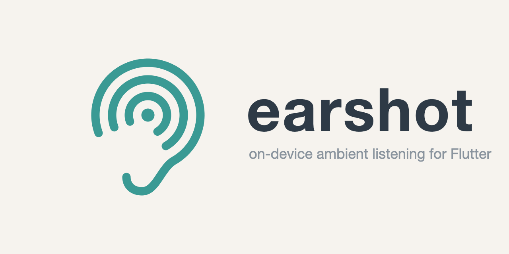

<p align="center">
  <picture>
    <source media="(prefers-color-scheme: dark)" srcset="https://raw.githubusercontent.com/4rthurmonteiro/earshot_plugin/main/assets/brand/earshot_banner_dark.png">
    
  </picture>
</p>

# earshot_plugin

[](https://pub.dev/packages/earshot_plugin)
[](https://pub.dev/packages/very_good_analysis)
[](https://opensource.org/licenses/MIT)

> [!WARNING]
> **Pre-release (0.x).** The public API may still change in 0.x. See the [feature checklist](https://github.com/4rthurmonteiro/earshot_plugin#feature-checklist) for what works today.

On-device ambient listening for Flutter: how loud it is, in dB(A), and what is sounding, in one stream. This is the umbrella package for `earshot_capture`, `earshot_level` and `earshot_classifier`.

Part of [earshot](https://github.com/4rthurmonteiro/earshot_plugin): on-device ambient listening with no network access, where no audio leaves the device.

## Usage

```dart
import 'package:earshot_plugin/earshot_plugin.dart';

// Ask for the microphone first, or the stream fails with permissionDenied.
await const MicrophonePermission().request();

final subscription = const Earshot()
    .listen(
      options: const EarshotOptions(
        level: LevelOptions(weighting: Weighting.a),
        classifier: ClassifierOptions(minConfidence: 0.5),
      ),
    )
    .listen(
      (event) {
        // One event per level reading, with the sounds confirmed since the
        // previous event. sound is null when a label maps to no EarshotSound.
        print('${event.level?.db} dB(A)');
        for (final detection in event.detections) {
          print('${detection.group} ${detection.sound} ${detection.rawLabel}');
        }
      },
      onError: (Object error) {
        if (error is EarshotException) print(error.code);
      },
    );

// Cancelling stops the microphone, the level meter and the classifier.
await subscription.cancel();
```

Set `level` or `classifier` to `null` to turn one off. With level metering off, each confirmed sound is an event of its own.

## How it listens

- **One microphone session.** One capture subscription feeds the level meter and the classifier, whatever its backend. Capture runs at `EarshotOptions.capture`, 16 kHz by default: the rate YAMNet runs at, so classification needs no resampling. The level meter works at every rate, but at 16 kHz it cannot measure above 8 kHz. Choose `SampleRate.hz48000` for a full-band level; YAMNet then resamples to 16 kHz.
- **Backends.** The classifier reads the shared capture stream through `EarshotClassifier.classify`, which picks the backend. `apple`, and a `null` backend on iOS and macOS, run Apple SoundAnalysis at the capture rate. `yamnet`, and a `null` backend elsewhere, run YAMNet. Level readings and detections share the capture clock.
- **Subscriptions.** Each `listen()` starts its own session, and cancelling it stops everything it started. Pausing pauses capture and the classifier, and buffers audio in memory, so cancel rather than pause for long breaks.

## Errors

Failures arrive as one `EarshotException` stream error, after which the stream closes. `cause` keeps the original error.

| `EarshotErrorCode` | When |
| --- | --- |
| `permissionDenied` | The user denied microphone access, or has not granted it yet. |
| `unsupported` | The platform or backend is not supported, for example `apple` on Android. |
| `audioUnavailable` | The microphone could not be opened or recovered. |
| `sampleRateConflict` | Another consumer in the app captures at a different sample rate. |
| `modelUnavailable` | The classifier could not load its model, or failed while classifying. |
| `unknown` | Anything else, including invalid classifier options such as a `minConfidence` outside 0 to 1. |

New codes may be added in a minor version, so keep a wildcard case when you switch on them. The same goes for `EarshotSound`, `SoundGroup`, `ClassifierBackend`, `SampleRate`, `CaptureState`, `CaptureErrorCode`, `ClassifierErrorCode` and `MicrophonePermissionStatus`.

```dart
final message = switch (error.code) {
  EarshotErrorCode.permissionDenied => 'Allow the microphone in Settings.',
  EarshotErrorCode.unsupported => 'Not available on this device.',
  _ => 'Something went wrong.',
};
```

## Microphone setup

Your app declares microphone access, not this package:

- **iOS and macOS:** add `NSMicrophoneUsageDescription` to `Info.plist`. On macOS, also add the `com.apple.security.device.audio-input` entitlement.
- **Android:** `RECORD_AUDIO` is merged into your app's manifest by `earshot_capture_android`. Your app still asks the user at runtime.

## Minimum OS versions

Sound classification on Apple platforms uses SoundAnalysis, so apps that depend on this package need iOS 15 or macOS 12 or later.

## Disclaimer

earshot is informational and is not a certified detector. Never rely on it for safety, including smoke and carbon monoxide alarms.
